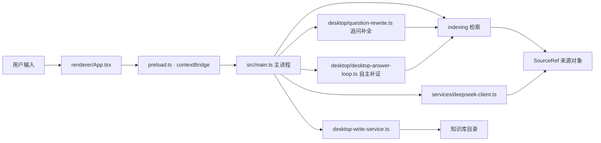

# 项目接手指南

> 面向第一次接触本项目、TypeScript 和 Agent 的接手者。读完本文应能知道项目为何存在、代码从哪里启动、每个目录负责什么、如何本地调试，以及怎样安全地改功能。

## 1. 用一句话理解项目

这是一个本地优先的个人知识 Agent 桌面应用：它检索你选定的 Markdown 知识库、用 DeepSeek 回答、用 Tavily 补证，并能把笔记组织成知识地图或 LLM Wiki。

它不是通用聊天机器人。项目的重点是：**让模型参与个人知识库，但文件读取、外发、写入和来源记录仍由本地代码控制。**

原项目同时维护 Obsidian 插件端与 Electron 桌面端，两端能力逐渐分叉。现插件端已完全移除，只保留桌面端；共享内核放在 `core/`，不引用任何 Obsidian API。

## 2. 先记住这五条规则

1. `src/main.ts` 是 Electron 主进程入口，负责服务组装与 IPC；`src/renderer/App.tsx` 是唯一界面。
2. API Key 不在知识库里，而在应用数据目录的 `.env`：`DEEPSEEK_API_KEY`、`TAVILY_API_KEY`。
3. 默认允许整个知识库；用户填写“敏感目录”后，其中内容仍可本地使用，但不能发送给模型。
4. 所有写入都要先生成预览、再由用户确认。不要在服务里直接调用仓储的写方法绕过预览。
5. `dist/` 是构建产物，不能手改；改动后运行 `npm.cmd run build`。

## 3. 系统地图



调用关系：界面只负责展示会话与写入预览；主进程组装服务；问答链路（`desktop-answer-loop.ts`）自己决定下一步动作，模型只输出决策与文本，任何模型都不能自行决定文件路径或写入动作。

## 4. 本地开发

```powershell
npm.cmd install
npm.cmd run dev      # 构建并启动 Electron
npm.cmd run typecheck
npm.cmd test
npm.cmd run build
```

`npm.cmd test` 使用 `vitest.config.ts`，与 `vite.config.ts` 分开，因为后者的 `root` 指向渲染层。

## 5. 目录与关键文件

| 路径 | 职责 |
| --- | --- |
| `src/main.ts` | 主进程：工作区生命周期、服务组装、IPC、问答链路宿主 |
| `src/preload.ts` | 通过 contextBridge 暴露最小 API |
| `src/renderer/App.tsx` | 中文单对话界面、笔记目录、写入预览卡片 |
| `src/shared/desktop-api.ts` | 主进程与渲染层共享的类型契约 |
| `core/core/knowledge-repository.ts` | 只读知识库接口（可替换实现） |
| `core/policy/policy-engine.ts` | 所有读、外发、索引、写入的授权中心 |
| `core/indexing/` | Markdown 分块、检索、附件索引与批处理队列 |
| `core/desktop/desktop-answer-loop.ts` | 问答循环：本地检索后由模型决定换词重检、联网或停止 |
| `core/desktop/question-rewrite.ts` | 追问判定与主语补全，回答前的检索入口 |
| `core/desktop/` | 桌面端服务：问答、写入、Wiki、附件、会话、关联、维护分析、主题梳理 |
| `core/services/` | DeepSeek / Tavily / Vision 客户端与请求适配 |
| `core/actions/` | 写入提案与渲染（安全文件名、来源去重） |
| `core/wiki/` | LLM Wiki 编译、检索与覆盖核验 |

## 6. 关键流程

### 6.1 追问补全

1. 渲染层把原话交给主进程，用户自己的措辞始终保留在屏幕上。
2. `question-rewrite.ts` 先本地判断这句话是否像追问（出现「它/这个/上面」等回指，或短到不可能自带主语）；不像是追问就直接放行，不花模型调用。
3. 像追问时，用最近会话上下文请模型把主语补全，输出一个可独立检索的问题；解析失败或模型认为无需改写时一律退回原句。
4. 补全后的问题用于检索与作答，并通过 `interpretedQuestion` 回传，界面显示“按上下文理解为：…”。

### 6.2 受控写入

1. 操作执行器生成 `DesktopWritePreview`（目标路径、写前内容、写后内容），不写盘。
2. 渲染层展示预览差异；用户点“确认写入”后调用 `write:apply-previews`。
3. `DesktopWriteService.apply()` 二次检查权限，并确认文件自预览后未被修改。

### 6.3 问答与补证

本地检索优先，并用 `local-halt` 模式把“证据不足”交回调用方：`desktop-answer-loop.ts` 让模型看着已尝试的动作自己决定下一步（换词重检 / 联网搜索 / 通用知识 / 停止），最多两轮，决策过程会显示在回答下方。关于助手自身行为的问题（“你刚才为什么没联网”）不走检索，直接读会话日志里的决策记录作答。

## 7. 数据边界

| 位置 | 内容 | 是否可删 |
| --- | --- | --- |
| 应用数据目录 `.env` | API Key | 可删；对应功能需重填 |
| Electron 用户数据目录 | 工作区路径、会话与附件索引状态 | 可删；会丢运行状态 |
| 知识库 Markdown/图片/PDF | 用户事实来源 | 不应由缓存逻辑删除 |
| `00 Inbox/Agent/`、`daily/`、知识体系目录 | 确认后写入的真实笔记 | 由用户管理 |

## 8. 如何安全地改常见需求

**新增一项权限**：在 `POLICY_ACTIONS` 与 `PermissionPolicy.enabled` 增加动作 → 在 `PolicyEngine.decide()` 加分支 → 在真正执行前调用 `decide()`。

**新增一个 Agent 能力**：明确的操作在 `desktop-intent-router.ts` 注册意图（短问句一律留在问答路径，避免误触发写入）→ 在 `src/main.ts` 的 `executeIntent()` 里执行 → 涉及写入就只生成预览。问答链路内部的补证动作改 `desktop-answer-loop.ts` 的 `AnswerLoopAction`，不要把工具编排重新变成外部计划。

**新增一种写入**：扩展 `DesktopWriteService`（`preparePreview` + `apply`），不要在服务里直接写仓储。

**更换模型或检索服务**：改 `core/services/` 对应客户端，HTTP 共享行为留在 `json-post.ts` / `fetch-api-request.ts`；不要把请求散到主进程或界面文件。

## 9. 发布前检查单

- [ ] `npm.cmd run typecheck` 通过。
- [ ] `npm.cmd test` 全部通过。
- [ ] `npm.cmd run build` 成功。
- [ ] 没有提交真实 `.env`、知识库样本或私密 PDF/图片。
- [ ] 手测：模型连通性、检索、问答计划、写入预览确认、敏感目录阻断、图片处理。

## 10. 已知限制

1. 检索是 BM25 打分（中文二元切分 + IDF + 词频饱和 + 长度归一）+ 结构化信号重排（标签、双链、目录、祖先标题、当前打开笔记的邻近度），未接入向量/语义检索，也没有查询改写。极小知识库（个位数笔记）里 IDF 样本不足，泛词仍可能占优；同义词/说法不同（"费用太贵" vs "成本高昂"）字面检索仍然召回不到。
2. PDF 当前不由模型解析。
3. LLM Wiki 重编译时，已存在的页面会被直接覆盖，不会检测人工修改（比对 registry 记录的内容哈希再做提示尚未实现）。另外增量编译的源召回仍是检索前 80 条，BM25 召回不到的笔记进不了 Wiki；概念页正文每节点一次模型调用，上限 12 个节点，超出的节点仍是提纲摘要。
4. 「梳理知识库」只把笔记的路径、标题、标签、双链与首段发给模型（全库正文放不进一次请求），因此主题划分的质量取决于笔记命名质量；分批调用中失败的那几批不会进入主题，回执里会点明失败批次数。
5. 尚无 CI、端到端测试与示例知识库。
